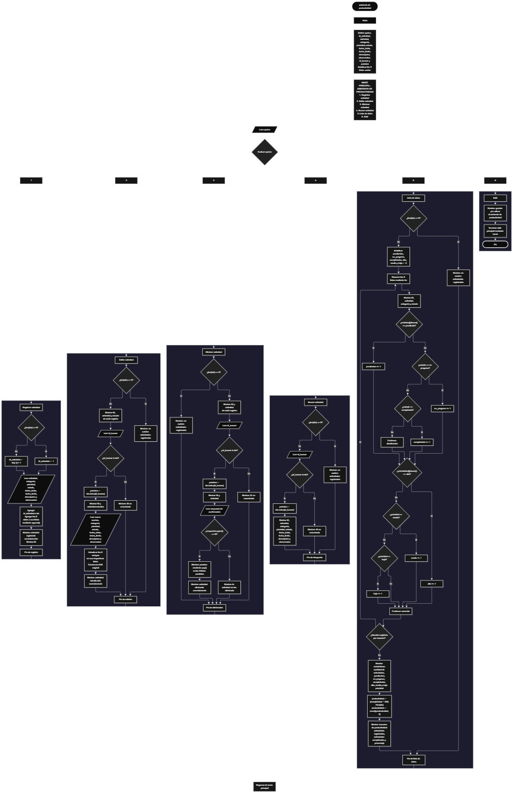

Este proyecto, llamado <b>asistente de productividad</b>, fue desarrollado en <b>python</b> como un ejercicio práctico para fortalecer la lógica de programación mediante la creación de un sistema de gestión de actividades desde la consola. El programa cuenta con un menú principal de seis opciones que permite <b>registrar, editar, eliminar, buscar y consultar las actividades</b> almacenadas, además de generar estadísticas sobre su estado y prioridad. Cada actividad almacena información como el nombre, la categoría, la prioridad, el estado, la fecha de inicio, la fecha límite, la descripción y las observaciones, utilizando nueve listas paralelas que organizan los registros durante la ejecución del programa. Durante su desarrollo se aplicaron conceptos fundamentales de programación, como variables, listas, estructuras condicionales, ciclos repetitivos, métodos de listas, generación automática de identificadores, búsqueda de registros y operaciones matemáticas para calcular el porcentaje de productividad. Este proyecto permite poner en práctica los conocimientos adquiridos en Python y sirve como base para desarrollar sistemas de organización y seguimiento de actividades más avanzados utilizando otros lenguajes y tecnologías.

<h2 align="center">⚙️ Funcionamiento del menú principal</h2>

### ➕ Registrar actividad

La opción <b>1) registrar actividad</b> permite agregar una nueva actividad al asistente de productividad. Antes de realizar el registro, el programa comprueba si la lista <b>ids</b> está vacía mediante la condición <b>len(ids) == 0</b>. Si no existen actividades registradas, asigna el identificador inicial <b>1</b> a la nueva actividad. En caso contrario, genera el siguiente identificador utilizando el último valor almacenado en la lista mediante la expresión <b>ids[-1] + 1</b>. Después, solicita los ocho datos correspondientes a la actividad: <b>nombre, categoría, prioridad, estado, fecha de inicio, fecha límite, descripción y observación</b>. Los datos se almacenan en sus respectivas listas utilizando el método <b>append()</b>, manteniendo la misma posición para cada registro en las nueve listas paralelas. Finalmente, muestra el mensaje <b>"actividad registrada correctamente."</b> e informa el identificador asignado a la actividad.

### ✏️ Editar actividad

La opción <b>2) editar actividad</b> permite modificar la información de una actividad previamente registrada. Primero, el programa comprueba si existen actividades almacenadas mediante la condición <b>len(ids) == 0</b>. Si no hay registros, muestra el mensaje <b>"no existen actividades registradas."</b>. En caso contrario, presenta una lista con el identificador, el nombre y el estado de cada actividad, utilizando un ciclo <b>for</b> para recorrer los registros. Después, solicita el identificador de la actividad que se desea editar y comprueba si existe mediante la condición <b>id_buscar in ids</b>. Si encuentra una coincidencia, utiliza el método <b>index()</b> para obtener la posición correspondiente y muestra el identificador y el nombre actuales. A continuación, solicita los nuevos valores de los ocho campos y actualiza directamente los datos en sus respectivas listas, conservando el identificador original. Finalmente, presenta el mensaje <b>"actividad actualizada correctamente."</b>. Si el identificador introducido no corresponde a una actividad registrada, muestra el mensaje <b>"id no encontrada."</b>.

### 🗑️ Eliminar actividad

La opción <b>3) eliminar actividad</b> permite eliminar una actividad registrada mediante su identificador. Antes de comenzar, el programa comprueba si existen registros almacenados. Si la lista <b>ids</b> está vacía, muestra el mensaje <b>"no existen actividades registradas."</b>. Si hay actividades disponibles, presenta una lista con el identificador y el nombre de cada registro. Después, solicita el identificador de la actividad que se desea eliminar y comprueba su existencia mediante la condición <b>id_buscar in ids</b>. Si encuentra la actividad, utiliza el método <b>index()</b> para localizar su posición y muestra su identificador y nombre. A continuación, solicita una confirmación mediante la pregunta <b>"¿desea eliminar esta actividad? (s/n): "</b>. Si la respuesta convertida a mayúsculas mediante <b>respuesta.upper() == "S"</b> coincide con la letra <b>S</b>, el programa elimina los datos de la posición correspondiente utilizando el método <b>pop()</b> en las nueve listas paralelas. Finalmente, muestra el mensaje <b>"actividad eliminada correctamente."</b>. Si el usuario no confirma la eliminación, presenta el mensaje <b>"la actividad no fue eliminada."</b>. Si el identificador no existe, informa mediante el mensaje <b>"id no encontrada."</b>.

### 🔎 Buscar actividad

La opción <b>4) buscar actividad</b> permite localizar una actividad mediante su identificador y consultar toda su información. Primero, el programa comprueba si existen actividades registradas. Si la lista <b>ids</b> está vacía, muestra el mensaje <b>"no existen actividades registradas."</b>. En caso contrario, solicita el identificador de la actividad que se desea buscar y verifica su existencia mediante la condición <b>id_buscar in ids</b>. Cuando encuentra una coincidencia, utiliza el método <b>index()</b> para obtener la posición del registro y mostrar todos sus datos: <b>identificador, nombre, categoría, prioridad, estado, fecha de inicio, fecha límite, descripción y observación</b>. Si el identificador introducido no corresponde a ninguna actividad registrada, presenta el mensaje <b>"id no encontrada."</b>. Esta función facilita consultar la información completa de una actividad sin necesidad de recorrer manualmente todos los registros.

### 📋 Lista de datos

La opción <b>5) lista de datos</b> permite visualizar las actividades registradas y obtener estadísticas generales sobre su estado, prioridad y productividad. Primero, el programa comprueba si existen actividades almacenadas. Si no hay registros, muestra el mensaje <b>"no existen actividades registradas."</b>. Si existen actividades, inicializa seis contadores: <b>pendientes, en_progreso, completadas, alta, media y baja</b>, todos con valor inicial cero. Después, utiliza un ciclo <b>for</b> para recorrer las listas y mostrar el identificador, nombre, categoría y estado de cada actividad. Durante el recorrido, emplea el método <b>lower()</b> para comparar los estados y las prioridades sin distinguir entre mayúsculas y minúsculas. De esta manera, incrementa los contadores correspondientes cuando encuentra los valores <b>"pendiente", "en progreso", "completada", "alta", "media o "baja"</b>. Al finalizar, muestra las estadísticas del asistente de productividad, incluyendo la cantidad total de actividades registradas, los estados y las prioridades. Posteriormente, calcula el porcentaje de productividad mediante la expresión <b>(completadas * 100) / len(ids)</b> y utiliza <b>round(productividad, 2)</b> para redondear el resultado a dos decimales. Finalmente, presenta un resumen con las actividades registradas, las actividades completadas y el porcentaje de productividad obtenido.

### 🚪 Salir del menú principal

La opción <b>6) salir</b> está destinada a finalizar la ejecución del programa. Cuando el usuario selecciona esta opción, el programa muestra el mensaje <b>"gracias por utilizar el asistente de productividad."</b> y utiliza la instrucción <b>break</b> para interrumpir el ciclo <b>while True</b> que mantiene activo el menú principal. De esta manera, finaliza la ejecución del asistente y permite salir del sistema después de realizar las operaciones disponibles.

<h2 align="center">🧠 Temas aplicados en el proyecto</h2>

### 📦 Variables

En este proyecto se utilizan variables para almacenar los datos de las actividades, controlar la opción seleccionada en el menú, generar identificadores, localizar registros, administrar las estadísticas y calcular el porcentaje de productividad. Cada variable cumple una función específica dentro de las operaciones de gestión de actividades y permite organizar el funcionamiento del programa.

🔢 **Opcion:** Almacena la opción seleccionada por el usuario en el menú principal.

🆔 **Id_actividad:** Almacena el identificador generado automáticamente para una nueva actividad.

📝 **Actividad:** Almacena el nombre de la actividad que se desea registrar o actualizar.

📂 **Categoria:** Almacena la categoría correspondiente a cada actividad.

⚡ **Prioridad:** Almacena el nivel de prioridad de la actividad.

📊 **Estado:** Almacena la situación actual de la actividad.

📅 **Fecha_inicio:** Almacena la fecha en la que comienza la actividad.

⏳ **Fecha_limite:** Almacena la fecha establecida para finalizar la actividad.

📄 **Descripcion:** Almacena los detalles descriptivos de la actividad.

📌 **Observacion:** Almacena información adicional relacionada con la actividad.

🔎 **Id_buscar:** Almacena el identificador introducido por el usuario para localizar un registro.

🔢 **Posicion:** Almacena el índice correspondiente a la actividad encontrada en las listas.

📈 **Pendientes, En_progreso y Completadas:** Almacenan las cantidades de actividades clasificadas según su estado.

⚡ **Alta, Media y Baja:** Almacenan las cantidades de actividades clasificadas según su prioridad.

📊 **Productividad:** Almacena el porcentaje calculado a partir de las actividades completadas y el total de actividades registradas.

### 🗃️ Listas

En este proyecto se utilizan nueve listas paralelas para almacenar la información de las actividades registradas. Todas comienzan vacías y utilizan la misma posición para relacionar los datos de una misma actividad. Por ejemplo, la información del registro ubicado en la posición <b>0</b> se distribuye entre <b>ids[0], actividades[0], categorias[0], prioridades[0], estados[0], fechas_inicio[0], fechas_limite[0], descripciones[0] y observaciones[0]</b>. Esta organización permite registrar, buscar, modificar, mostrar y eliminar las actividades mediante sus posiciones correspondientes. Las listas no tienen una capacidad máxima establecida en el código y conservan los datos únicamente durante la ejecución del programa.

🆔 **Ids:** Almacena los identificadores de las actividades registradas.

📝 **Actividades:** Almacena los nombres de las actividades.

📂 **Categorias:** Almacena las categorías de cada actividad.

⚡ **Prioridades:** Almacena los niveles de prioridad: alta, media o baja.

📊 **Estados:** Almacena los estados de las actividades: pendiente, en progreso o completada.

📅 **Fechas_inicio:** Almacena las fechas de inicio de las actividades.

⏳ **Fechas_limite:** Almacena las fechas límite de las actividades.

📄 **Descripciones:** Almacena las descripciones de los registros.

📌 **Observaciones:** Almacena las observaciones adicionales de cada actividad.

### 🔀 Estructuras condicionales

En este proyecto se utilizan las estructuras <b>if, elif y else</b> para controlar las diferentes operaciones del menú principal y comprobar las condiciones necesarias para administrar las actividades. Estas estructuras permiten verificar si existen registros antes de realizar una operación, determinar si un identificador se encuentra almacenado, comprobar si el usuario confirma una eliminación y seleccionar los contadores correspondientes según el estado y la prioridad de cada actividad. También permiten controlar la opción seleccionada y mostrar un mensaje cuando el usuario introduce una opción que no está definida en el menú.

### 🔄 Estructuras repetitivas

En este proyecto se utilizan los ciclos <b>while</b> y <b>for</b> para mantener el funcionamiento del menú y recorrer las listas de actividades. El ciclo <b>while True</b> mantiene activo el menú principal hasta que el usuario selecciona la opción de salida y se ejecuta la instrucción <b>break</b>. Por otro lado, los ciclos <b>for</b> permiten recorrer los registros para mostrar las actividades almacenadas, presentar los datos antes de editar o eliminar y calcular las estadísticas según los estados y las prioridades. Estos ciclos facilitan trabajar con todos los registros sin necesidad de consultar cada posición manualmente.

### 🎯 Estructura de selección

El programa utiliza una estructura condicional formada por <b>if, elif y else</b> para evaluar el valor almacenado en la variable <b>opcion</b> y ejecutar las instrucciones correspondientes a cada alternativa del menú principal. Cada condición representa una operación específica del asistente: <b>registrar, editar, eliminar, buscar, consultar la lista de datos o salir</b>. También se utiliza la condición <b>else</b> para mostrar el mensaje <b>"opción no válida."</b> cuando el usuario introduce un valor que no coincide con ninguna de las opciones disponibles.

### 🔢 Generación automática de identificadores

El programa utiliza una condición para asignar automáticamente un identificador a cada nueva actividad. Cuando la lista <b>ids</b> está vacía, asigna el valor <b>1</b> mediante la variable <b>id_actividad</b>. Si existen registros, obtiene el último identificador almacenado utilizando <b>ids[-1]</b> y le suma uno mediante la expresión <b>ids[-1] + 1</b>. De esta manera, cada nueva actividad recibe un identificador que permite localizarla y relacionarla con sus datos correspondientes. Sin embargo, como el identificador se calcula tomando el último elemento de la lista, puede reutilizarse si se elimina el último registro antes de agregar una nueva actividad.

### 🔍 Búsqueda y comparación de registros

Para localizar actividades, el programa utiliza el operador <b>in</b> y el método <b>index()</b>. Primero, comprueba si el identificador introducido se encuentra dentro de la lista <b>ids</b>. Cuando existe una coincidencia, utiliza <b>index()</b> para obtener la posición exacta del registro y acceder a los datos almacenados en las demás listas paralelas. Además, utiliza el método <b>lower()</b> para comparar los estados y las prioridades sin distinguir entre letras mayúsculas y minúsculas durante el cálculo de las estadísticas.

### 📊 Contadores y estadísticas

El programa utiliza seis contadores para clasificar las actividades según su estado y prioridad. Los contadores <b>pendientes, en_progreso y completadas</b> permiten conocer cuántas actividades se encuentran en cada situación. Por otro lado, los contadores <b>alta, media y baja</b> permiten identificar cuántas actividades pertenecen a cada nivel de prioridad. Estos valores se incrementan mediante el operador <b>+= 1</b> durante el recorrido de las listas. Al finalizar, se muestran las cantidades obtenidas junto con el total de actividades registradas, proporcionando una visión general de la organización de las actividades.

### 📐 Cálculo del porcentaje de productividad

El programa calcula el porcentaje de productividad utilizando la cantidad de actividades completadas y el total de actividades registradas. Para obtener este resultado, multiplica el contador <b>completadas</b> por <b>100</b> y divide el resultado entre la cantidad de registros almacenados en <b>ids</b>. La operación se realiza mediante la expresión <b>(completadas * 100) / len(ids)</b>. Posteriormente, utiliza la función <b>round()</b> para redondear el porcentaje a dos decimales. Este cálculo permite conocer qué proporción de las actividades registradas ha alcanzado el estado de completada.

<h2 align="center">¿Cómo se implementaron las operaciones crud en el proyecto?</h2>

Las operaciones <b>crud</b> se implementaron mediante las opciones del menú principal, permitiendo administrar las actividades registradas en el asistente de productividad. La operación <b>crear</b> corresponde a <b>registrar actividad</b>, donde se solicitan los datos de una nueva actividad y se almacenan mediante el método <b>append()</b>. La operación <b>leer</b> se realiza mediante las opciones <b>buscar actividad y lista de datos</b>, que permiten consultar los registros individuales y visualizar las actividades junto con sus estadísticas. La operación <b>actualizar</b> corresponde a <b>editar actividad</b>, donde se localiza un registro mediante su identificador y se modifican sus ocho campos de información. Finalmente, la operación <b>eliminar</b> se realiza mediante <b>eliminar actividad</b>, donde se solicita una confirmación y se eliminan los datos correspondientes utilizando el método <b>pop()</b> en las nueve listas paralelas. Estas operaciones utilizan variables, listas, condicionales y ciclos para gestionar la información almacenada temporalmente durante la ejecución del programa.

<h2 align="center">Diagrama de flujo del proyecto</h2>

<h2 align="center">🛡️ Validaciones del programa</h2>

### 📭 No existen actividades registradas

Esta comprobación se utiliza en las opciones de <b>editar, eliminar, buscar y lista de datos</b>. El programa verifica si la lista <b>ids</b> está vacía mediante la condición <b>len(ids) == 0</b>. Si no existen actividades registradas, muestra el mensaje <b>"no existen actividades registradas."</b> y evita continuar con las operaciones que necesitan información almacenada. Esta comprobación permite controlar el acceso a los registros cuando todavía no se ha agregado ninguna actividad.

### ❌ Identificador no encontrado

Esta comprobación se utiliza durante las operaciones de <b>editar, eliminar y buscar actividad</b>. El programa verifica si el identificador introducido por el usuario se encuentra dentro de la lista <b>ids</b> mediante la condición <b>id_buscar in ids</b>. Si encuentra una coincidencia, obtiene la posición correspondiente utilizando el método <b>index()</b> y continúa con la operación seleccionada. Si el identificador no existe, muestra el mensaje <b>"id no encontrada."</b>, evitando acceder a una posición que no corresponde a un registro almacenado.

### ⚠️ Confirmación de eliminación

Esta comprobación se utiliza durante la eliminación de una actividad. Después de localizar el registro y mostrar su identificador y nombre, el programa solicita al usuario que confirme la operación. Para determinar si la eliminación debe realizarse, utiliza la condición <b>respuesta.upper() == "S"</b>, que permite aceptar la letra <b>S</b> tanto en mayúscula como en minúscula. Si se cumple la condición, elimina los datos de las nueve listas mediante <b>pop(posicion)</b>. Si la respuesta es diferente, muestra el mensaje <b>"la actividad no fue eliminada."</b> y conserva los registros almacenados.

### 📊 Clasificación de estados y prioridades

Durante la generación de estadísticas, el programa utiliza comparaciones para clasificar las actividades según sus estados y prioridades. Mediante el método <b>lower()</b>, convierte temporalmente los valores a minúsculas para compararlos con las categorías esperadas. Los estados reconocidos son <b>"pendiente", "en progreso" y "completada"</b>, mientras que las prioridades reconocidas son <b>"alta", "media" y "baja"</b>. Los valores que no coinciden con estas opciones no incrementan ninguno de los contadores correspondientes. Es importante señalar que el programa realiza estas comparaciones para las estadísticas, pero no impide que el usuario introduzca otros valores durante el registro o la edición.

### 📈 Cálculo de productividad

El programa calcula la productividad únicamente cuando existen actividades registradas, debido a que esta operación se encuentra dentro de la condición que comprueba que la lista <b>ids</b> no esté vacía. Para obtener el porcentaje, utiliza la cantidad de actividades completadas y la divide entre el total de actividades registradas, multiplicando el resultado por <b>100</b>. Posteriormente, utiliza <b>round(productividad, 2)</b> para mostrar el porcentaje con dos decimales. Este cálculo no considera únicamente las actividades que están pendientes o en progreso, sino que utiliza todos los registros almacenados como base para obtener el resultado.

### ⚠️ Datos y entradas del usuario

El programa solicita los datos de cada actividad mediante la función <b>input()</b>, pero actualmente no comprueba si los campos están vacíos ni restringe las categorías, prioridades o estados a valores específicos. Tampoco verifica el formato de las fechas ni controla las entradas no numéricas al convertir el identificador mediante <b>int()</b>. Por otra parte, los registros se almacenan en listas que permanecen únicamente durante la ejecución del programa, por lo que la información se pierde al finalizarlo. Estas características representan limitaciones de la versión actual y permiten identificar posibles mejoras para futuras versiones del asistente de productividad.

### ⚠️ Opción no válida

La estructura condicional del menú principal incluye un bloque <b>else</b> que permite controlar las opciones que no corresponden a ninguna de las seis alternativas disponibles. Cuando el usuario introduce un valor diferente de <b>1, 2, 3, 4, 5 o 6</b>, el programa muestra el mensaje <b>"opción no válida."</b>. Esta comprobación permite mantener el funcionamiento del menú y solicitar una nueva selección sin finalizar la ejecución del programa.

<h2 align="center">🎯 Objetivo del proyecto</h2>

El objetivo principal de este proyecto es fortalecer la <b>lógica de programación</b> mediante el desarrollo de un sistema de gestión de actividades en <b>python</b>. A través de su construcción se busca aplicar los conocimientos adquiridos sobre variables, listas, estructuras condicionales, ciclos repetitivos, métodos y operaciones matemáticas, integrándolos para resolver un problema de organización y seguimiento de tareas. Además, el proyecto permite comprender cómo registrar, consultar, modificar y eliminar información mediante listas paralelas, generar identificadores automáticamente, clasificar actividades según su estado y prioridad, y calcular estadísticas para conocer el porcentaje de productividad. De esta manera, se establece una base para desarrollar sistemas de gestión más completos y aplicaciones orientadas a mejorar la organización personal mediante otros lenguajes y tecnologías.

